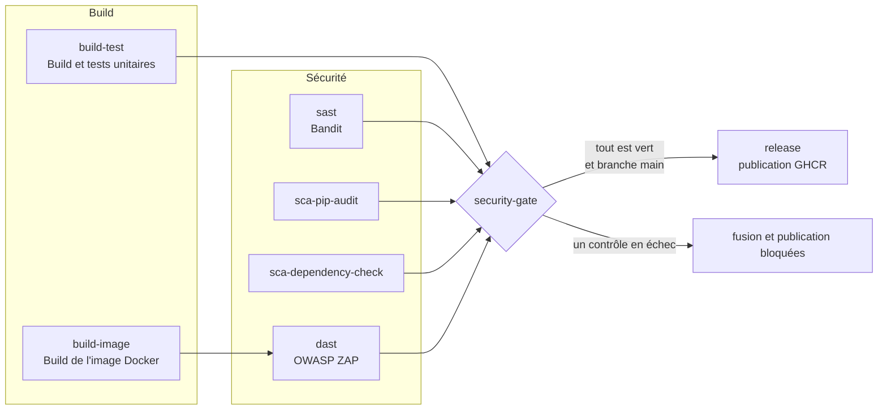

# TP2 — Intégration de la sécurité dans un pipeline CI/CD

| | |
|---|---|
| **Étudiant** | Yassine Dahmoul — GRP1 |
| **Encadrante** | Saloua BEN YAHIA |
| **Date** | 29 octobre 2026 |
| **Projet** | *Notes App* — application web Python/Flask issue du TP1 (ce dépôt) |
| **Plateforme CI/CD** | GitHub Actions — dépôt [`YassineDHML/tp2-devsecops-cicd-pipeline`](https://github.com/YassineDHML/tp2-devsecops-cicd-pipeline) |
| **Outils** | pytest 9.2.0 · Bandit 1.9.4 (SAST) · pip-audit 2.10.1 et OWASP Dependency-Check 13.0.0 (SCA) · OWASP ZAP 2.17.0 (DAST) · Docker |

---

## Sommaire

1. [Objectifs et principes](#1-objectifs-et-principes)
2. [Architecture du pipeline](#2-architecture-du-pipeline)
3. [Phase 1 : pipeline de base (compiler et tester)](#3-phase-1--pipeline-de-base-compiler-et-tester)
4. [Phase 2 : SAST et SCA avec seuils bloquants](#4-phase-2--sast-et-sca-avec-seuils-bloquants)
5. [Phase 3 : DAST sur un environnement éphémère](#5-phase-3--dast-sur-un-environnement-éphémère)
6. [Security gate, protection de la branche et publication conditionnelle](#6-security-gate-protection-de-la-branche-et-publication-conditionnelle)
7. [Validation : pull request vulnérable, puis corrigée](#7-validation--pull-request-vulnérable-puis-corrigée)
8. [Bilan](#8-bilan)
9. [Annexes](#9-annexes)

---

## 1. Objectifs et principes

### 1.1 Du scan manuel au pipeline « garde-fou »

Au TP1, les scans SAST et SCA étaient lancés à la main, une seule fois. Cela pose trois problèmes :

1. rien n'oblige quelqu'un à les relancer après chaque modification ;
2. chaque nouveau commit peut introduire une faille ;
3. de nouvelles vulnérabilités sont publiées chaque jour sur des dépendances qui n'ont pas changé (un cas réel est survenu pendant ce TP, voir [§4.6](#46-un-constat-réel--une-dépendance-du-tp1-devenue-vulnérable)).

Un pipeline CI/CD règle ces trois problèmes : les contrôles s'exécutent **automatiquement, à chaque modification, de la même façon pour tout le monde**, et leur résultat **décide** de ce qui peut être fusionné et publié. Le pipeline devient un **garde-fou** (*guardrail*). Il ne remplace pas la revue de code, mais il ne peut pas être oublié ni contourné par manque de temps.

| Terme | Signification |
|---|---|
| **CI** (intégration continue) | Chaque modification est intégrée fréquemment et validée automatiquement (compilation, tests). |
| **CD** (livraison continue) | Ce qui a été validé est livré automatiquement. Ici : publication de l'image Docker. |
| **DevSecOps** | Intégrer des contrôles de sécurité dans ces étapes plutôt qu'en fin de projet. |
| **Shift-left** | Détecter les failles le plus tôt possible, donc au moment du commit ou de la pull request. |
| **Security gate** | Point de contrôle automatique dont l'échec bloque la suite du pipeline. |

### 1.2 Trois contrôles complémentaires

| | **SAST** | **SCA** | **DAST** |
|---|---|---|---|
| Nom | *Static Application Security Testing* | *Software Composition Analysis* | *Dynamic Application Security Testing* |
| Ce qui est analysé | Notre code source | Les bibliothèques tierces | L'application **en cours d'exécution** (boîte noire) |
| Application lancée ? | Non | Non | Oui, dans un environnement éphémère |
| Exemples de failles trouvées | Injection de commande, secret en dur, fonction dangereuse | CVE dans une dépendance | XSS, injection exploitable, cookies et en-têtes mal configurés |
| Ce qu'il ne voit pas | La configuration à l'exécution, ce qui est généré dynamiquement | Les failles de notre propre code | Le code que le scanner n'atteint pas, les failles de logique |
| Outil utilisé | **Bandit** | **pip-audit** et **OWASP Dependency-Check** | **OWASP ZAP** |

Aucun des trois ne suffit seul. La démonstration du [§7](#7-validation--pull-request-vulnérable-puis-corrigée) le montre : une même route vulnérable est vue **en partie** par le SAST et **en partie** par le DAST.

### 1.3 Principes de conception du pipeline

| # | Principe | Mise en œuvre |
|---|---|---|
| 1 | **Échouer fermé** : pas de rapport exploitable = pas de feu vert | `scripts/security_report.py` renvoie le code 2 si le rapport est absent ou vide ; le job `security-gate` échoue si un contrôle est ignoré ou annulé |
| 2 | **Seuils explicites** et définis en un seul endroit | variables `BANDIT_FAIL_LEVEL` et `DC_FAIL_ON_CVSS` en tête de `ci.yml`, tableau du [§4.1](#41-politique-de-blocage) |
| 3 | **Contrôles indépendants et parallèles** | un seul run donne la liste complète des problèmes, en environ 6 minutes |
| 4 | **Un seul feu vert** | le job `Security gate` est le seul contrôle exigé par la protection de branche |
| 5 | **Construire une fois, tester et publier le même artefact** | l'image Docker est construite par `build-image`, testée par le DAST puis publiée telle quelle par `release` |
| 6 | **Moindre privilège** | `permissions: contents: read` ; seul le job `release` obtient `packages: write` |
| 7 | **Chaîne d'approvisionnement maîtrisée** | actions GitHub épinglées par empreinte de commit ; images des scanners épinglées par version |
| 8 | **Environnement éphémère, secrets jetables** | réseau et conteneur détruits en fin de job ; mots de passe générés à la volée, jamais écrits dans le dépôt |
| 9 | **Contrôle continu** | exécution hebdomadaire planifiée, pour détecter les nouvelles CVE sans nouveau commit |

---

## 2. Architecture du pipeline

### 2.1 Contenu du dépôt

```
.
├── .github/workflows/ci.yml     # le pipeline (un seul fichier)
├── app/                         # application Flask issue du TP1
│   ├── app.py
│   └── templates/
├── tests/
│   ├── conftest.py
│   ├── test_app.py              # tests de l'application
│   └── test_security_report.py  # tests du script de gate
├── scripts/
│   ├── dast.sh                  # environnement éphémère, scan ZAP, gate, destruction
│   └── security_report.py       # résumés des rapports et règle de blocage du DAST
├── zap/automation.yaml          # plan ZAP : scan authentifié
├── reports/                     # preuves d'exécution (voir §7 et annexe C)
├── Dockerfile
├── requirements.txt             # dépendances de l'application (analysées par la SCA)
├── requirements-dev.txt         # pytest, pytest-cov, Bandit, pip-audit
└── RAPPORT.md
```

### 2.2 Les jobs et leurs dépendances



| Job (nom affiché) | Dépend de | Rôle | Durée mesurée* |
|---|---|---|---|
| `build-test` — Build et tests unitaires | — | compilation, tests, couverture | 35 s |
| `build-image` — Build de l'image Docker | — | construit et exporte l'image | 30 s |
| `sast` — SAST - Bandit | — | analyse statique du code | 13 s |
| `sca-pip-audit` — SCA - pip-audit | — | vulnérabilités des dépendances (base PyPA/OSV) | 17 s |
| `sca-dependency-check` — SCA - OWASP Dependency-Check | — | vulnérabilités des dépendances (base NVD) | 34 s |
| `dast` — DAST - OWASP ZAP | `build-image` | scan dynamique sur environnement éphémère | 4 min 46 s |
| `security-gate` — Security gate | tous les jobs précédents | agrège les résultats | 2 s |
| `release` — Release | `security-gate` | publie l'image (branche `main` uniquement) | 32 s |

\* Premier run complet sur `main` (cache de la base NVD vide). Le run dure environ 6 minutes : il est dominé par le DAST (qui attend la construction de l'image), les autres contrôles s'exécutent en parallèle.

### 2.3 Déclencheurs

| Événement | Effet |
|---|---|
| `pull_request` vers `main` | contrôle la modification **avant** la fusion : c'est là que le garde-fou agit |
| `push` sur `main` | contrôle le code fusionné et, si tout est vert, déclenche la publication |
| `schedule` (lundi, 05:17 UTC) | détecte les nouvelles CVE même si personne ne commite |
| `workflow_dispatch` | lancement manuel |

---

## 3. Phase 1 : pipeline de base (compiler et tester)

### 3.1 L'application et ses tests

L'application est la version corrigée du TP1 (*Notes App* : comptes utilisateurs, notes, recherche, import YAML, préférences, deux outils réseau). Pour que le pipeline ait quelque chose à vérifier, une suite de tests `pytest` a été ajoutée (client de test Flask, base SQLite temporaire pour chaque test) :

- **comportement fonctionnel** : inscription, connexion, déconnexion, notes, recherche, import, préférences ;
- **propriétés de sécurité corrigées au TP1** : requêtes paramétrées (injection SQL), échappement HTML, mots de passe hachés, cookie `HttpOnly`/`SameSite`, YAML sûr, ping sans shell, protection anti-SSRF, en-têtes de sécurité. Si l'une de ces corrections était annulée par erreur, un test échouerait ;
- **script de gate** : `tests/test_security_report.py` vérifie la règle de blocage elle-même, car un garde-fou défaillant est pire que pas de garde-fou.

Au total, **78 tests** (dont 14 pour le script de gate) et **99 % de couverture** (lignes et branches) de `app/app.py`. Le seuil exigé par le pipeline est de 90 %.

### 3.2 Étude du fichier `.github/workflows/ci.yml`

| Bloc du fichier | Rôle |
|---|---|
| `on: pull_request / push / schedule / workflow_dispatch` | déclencheurs (voir [§2.3](#23-déclencheurs)) |
| `permissions: contents: read` | moindre privilège : le jeton du workflow ne peut que lire le dépôt. Le job `release` élève localement ce droit à `packages: write` |
| `concurrency` | une nouvelle poussée sur une PR annule l'exécution précédente (économie de minutes). Jamais sur `main` : une publication en cours n'est pas interrompue |
| `env` | seuils de blocage (`BANDIT_FAIL_LEVEL`, `DC_FAIL_ON_CVSS`) et version de Python, définis une seule fois |
| `uses: actions/…@<empreinte> # vX.Y.Z` | actions épinglées par **empreinte de commit** : un tag peut être déplacé par un attaquant qui prend le contrôle d'une action, pas une empreinte |
| `timeout-minutes` | un job bloqué ne consomme pas de minutes indéfiniment |
| `if: always()` | exécute l'étape même si une étape précédente a échoué : publication des rapports, destruction de l'environnement éphémère |
| `needs` | ordonne les jobs (le DAST attend l'image, la release attend le gate) |

Les actions utilisées :

| Action | Version | Usage |
|---|---|---|
| `actions/checkout` | v7.0.1 | récupère le code |
| `actions/setup-python` | v7.1.0 | installe Python 3.13 avec cache `pip` |
| `actions/cache` | v6.1.0 | cache hebdomadaire de la base NVD de Dependency-Check |
| `actions/upload-artifact` | v7.0.2 | publie les rapports et l'image |
| `actions/download-artifact` | v8.0.2 | récupère l'image dans les jobs `dast` et `release` |

### 3.3 Les deux jobs de la phase 1

**`build-test`**. Python n'est pas compilé, mais deux étapes jouent ce rôle :

1. `python -m compileall -q app tests scripts` compile en byte-code **tous** les fichiers, y compris ceux qu'aucun test n'importe : une erreur de syntaxe est détectée même dans un script rarement utilisé ;
2. `pytest --cov=app --cov-fail-under=90` exécute les tests et échoue si la couverture est insuffisante. Les rapports JUnit et de couverture sont publiés en artefacts.

**`build-image`**. `docker build` construit **le livrable** (l'image), ce qui vérifie que le `Dockerfile` et `requirements.txt` sont cohérents. L'image est étiquetée avec le SHA du commit, exportée (`docker save`) et publiée comme artefact d'une journée. Le DAST la teste et la release la publie : **c'est exactement la même image**, pas une reconstruction.

---

## 4. Phase 2 : SAST et SCA avec seuils bloquants

### 4.1 Politique de blocage

Le sujet demande de bloquer le pipeline en cas de vulnérabilité **critique ou de haute sévérité**. Chaque outil a sa propre échelle ; le tableau montre comment la règle est traduite pour chacun.

| Outil | Échelle native | Seuil de blocage | Mécanisme |
|---|---|---|---|
| **Bandit** (SAST) | Low, Medium, High (et un niveau de confiance) | **High** | `bandit -r app --severity-level high` : code de sortie 1 |
| **pip-audit** (SCA) | pas de score : la base PyPA/OSV ne fournit pas de CVSS | **toute vulnérabilité connue** | code de sortie 1 |
| **OWASP Dependency-Check** (SCA) | score CVSS : Low < 4 ≤ Medium < 7 ≤ High < 9 ≤ Critical | **CVSS ≥ 7** (High et Critical) | `--failOnCVSS 7` : code de sortie 15 |
| **OWASP ZAP** (DAST) | Informational, Low, Medium, High (pas de niveau Critical) | **High**, le niveau le plus élevé de ZAP | `security_report.py zap --fail-on high` : code de sortie 1 |

Les constatations de niveau inférieur ne bloquent pas, mais elles sont **affichées** (onglet *Summary* du run) et conservées dans les rapports.

> **Choix pour pip-audit.** Sans score CVSS, on ne peut pas distinguer une faille critique d'une faille mineure. La règle est donc plus stricte que celle du sujet : toute vulnérabilité connue bloque. Ce n'est pas pénalisant ici, car pip-audit indique toujours la version corrigée, et mettre à jour une dépendance épinglée coûte une ligne. Dependency-Check, lui, applique bien le seuil CVSS.
>
> **Choix pour Bandit.** Le seuil est *High*, comme demandé. Au TP1, l'application a été corrigée jusqu'au niveau *Medium* ; passer le seuil à *Medium* ne demande que de changer `BANDIT_FAIL_LEVEL`.

### 4.2 SAST : Bandit

```yaml
- name: Rapports complets (tous niveaux, non bloquants)
  run: |
    bandit -r app -f json -o ci-reports/bandit.json --exit-zero
    bandit -r app -f html -o ci-reports/bandit.html --exit-zero
    python scripts/security_report.py bandit ci-reports/bandit.json
- name: "GATE SAST : échec si une vulnérabilité de sévérité HIGH est détectée"
  run: bandit -r app --severity-level "$BANDIT_FAIL_LEVEL"
```

Le travail est fait en deux temps. D'abord les rapports **complets**, tous niveaux confondus (`--exit-zero` : cette étape ne bloque jamais). Ensuite le **gate**, qui relance Bandit avec le seuil et échoue si une constatation l'atteint. Ainsi les rapports sont toujours produits, et le journal du gate affiche directement le code fautif.

Résultat sur l'application saine : 2 constatations *Low* (`B404` import de `subprocess`, `B603` appel sans shell), déjà analysées et acceptées au TP1. Le gate passe.

### 4.3 SCA : pip-audit

```yaml
- name: Rapport JSON et résumé (non bloquants)
  run: |
    pip-audit -r requirements.txt --no-deps --disable-pip -f json -o ci-reports/pip-audit.json || true
    python scripts/security_report.py pip-audit ci-reports/pip-audit.json
- name: "GATE SCA (1/2) : échec si une dépendance a une vulnérabilité connue"
  run: pip-audit -r requirements.txt --no-deps --disable-pip --desc off
```

- `-r requirements.txt --no-deps` : analyse exactement les versions figées, y compris les dépendances transitives, sans résoudre de nouvelles versions ;
- `--disable-pip` : pas d'environnement virtuel temporaire (inutile puisqu'on n'installe rien) ;
- pip-audit interroge la base **PyPA / OSV** (avis GitHub, PyPI) et indique la **version corrigée**.

### 4.4 SCA : OWASP Dependency-Check

```yaml
docker run --rm \
  -v "$PWD:/src:ro" \
  -v "$HOME/dc-data:/usr/share/dependency-check/data" \
  -v "$PWD/ci-reports/dependency-check:/report" \
  owasp/dependency-check:13.0.0 \
  --project "TP2 Notes App" --scan /src \
  --exclude "**/.git/**" --exclude "**/ci-reports/**" \
  --enableExperimental --disableOssIndex \
  --nvdDatafeed "https://dependency-check.github.io/DependencyCheck_Builder/nvd_cache/" \
  --format HTML --format JSON --out /report \
  --failOnCVSS "$DC_FAIL_ON_CVSS"
```

| Option | Rôle |
|---|---|
| `--failOnCVSS 7` | **règle de blocage** : code de sortie 15 dès qu'une CVE a un score ≥ 7 |
| `--enableExperimental` | l'analyseur de `requirements.txt` est classé expérimental ; sans cette option, aucune dépendance Python n'est détectée (constaté au TP1) |
| `--nvdDatafeed` | miroir officiel de la base NVD : le téléchargement par l'API NVD est très lent sans clé d'API |
| `--disableOssIndex` | l'analyseur Sonatype OSS Index demande désormais un jeton |
| `-v …:/src:ro` | le code est monté en **lecture seule** |
| image `13.0.0` | version épinglée, pour des résultats reproductibles |

La base NVD (plusieurs centaines de Mo) est conservée d'un run à l'autre avec `actions/cache`, sous une clé **hebdomadaire** (`dc-data-2026-W44`) : elle est mise à jour une fois par semaine, et les runs intermédiaires ne retéléchargent que les différences.

Résultat sur l'application saine : 14 dépendances identifiées dans `requirements.txt`, **0 CVE**.

### 4.5 Lisibilité des résultats

`scripts/security_report.py` lit le rapport JSON de chaque outil et en écrit un résumé (comptes par niveau, détail des constatations) dans l'onglet *Summary* du run, sans avoir à ouvrir les journaux. Chaque job publie aussi ses rapports complets (JSON et HTML) comme **artefacts**.

Ce script est aussi, pour le DAST, l'endroit où est appliquée la règle de blocage ([§5.4](#54-règle-de-blocage)). Il est donc testé (`tests/test_security_report.py`), y compris le cas « rapport absent ou vide ».

### 4.6 Un constat réel : une dépendance du TP1 devenue vulnérable

En préparant ce TP, le contrôle `pip-audit` a été lancé en local sur le `requirements.txt` du TP1, **sans aucune modification du code** :

```
Found 2 known vulnerabilities in 1 package
Name    Version   ID              Fix Versions
certifi 2026.7.22 PYSEC-2026-4320 2026.10.18
certifi 2026.7.22 PYSEC-2026-4320 2026.10.19
```

L'avis (GHSA-6q48-6c7w-9gw2) a été publié le **20 octobre 2026**, soit après le TP1 : les versions de `certifi` antérieures à 2026.10.19 contiennent des certificats racine *emSign* dont des certificats intermédiaires ont des clés privées compromises. Un attaquant en position d'interception pourrait se faire passer pour n'importe quel site auprès de `requests`, `urllib3` ou `pip`. La dépendance a été mise à jour (`certifi==2026.10.23`, commit « SCA : mise à jour de certifi »).

Deux enseignements :

1. **Le code n'a pas changé, mais le risque, si.** C'est la raison d'être de l'exécution planifiée du pipeline (déclencheur `schedule`) : un projet « terminé » doit continuer à être contrôlé.
2. **Les outils SCA ne voient pas tous la même chose.** OWASP Dependency-Check, lancé en local sur la même version, a rapporté **0 vulnérabilité**. Son jeu de données (NVD) ne référence que les CVE, or cet avis n'avait pas (encore) d'identifiant CVE. pip-audit s'appuie sur la base PyPA/OSV, qui reçoit les avis GitHub avant l'attribution d'une CVE. C'est un argument pour **combiner deux sources**, comme au TP1.

---

## 5. Phase 3 : DAST sur un environnement éphémère

### 5.1 Pourquoi un DAST

Le SAST lit le code ; le DAST **attaque l'application qui tourne**, comme le ferait un attaquant, sans connaître le code. Il voit ce que le SAST ne peut pas voir : la configuration réelle (en-têtes, cookies), l'effet d'une entrée sur la page produite, ce qu'une route répond sans authentification. Le prix : il est plus lent (plusieurs minutes) et il faut une application déployée.

### 5.2 L'environnement éphémère

« Éphémère » signifie créé pour un seul scan, **identique à chaque fois**, et détruit ensuite. Le script `scripts/dast.sh` en pilote le cycle de vie ; le workflow appelle chaque étape séparément pour qu'elles soient visibles dans l'interface.

| Étape du job `dast` | Commande | Ce qui se passe |
|---|---|---|
| Charger l'image | `docker load` | récupère l'image construite par `build-image` (artefact) : c'est le livrable, pas une reconstruction |
| **Déployer** | `dast.sh deploy` | crée un réseau Docker dédié (`dast-net`), lance le conteneur applicatif (`app`), attend qu'il réponde, crée un compte de test |
| **Scanner** | `dast.sh scan` | lance ZAP dans un second conteneur du même réseau (cible `http://app:5000`) |
| **Gate** | `dast.sh gate` | lit le rapport ZAP, échoue s'il contient une alerte High |
| **Détruire** | `dast.sh destroy` (`if: always()`) | supprime le conteneur et le réseau, même si le scan a échoué ; enregistre les journaux de l'application |

Propriétés de sécurité de cet environnement :

| Propriété | Mise en œuvre |
|---|---|
| Isolation | réseau Docker dédié ; le port de l'application n'est publié que sur `127.0.0.1` du runner |
| Secrets jetables | `SECRET_KEY` et mot de passe du compte de test générés avec `openssl rand -hex` à chaque exécution ; le mot de passe est stocké dans un fichier en mode `0600` supprimé à la fin ; **rien dans le dépôt ni dans l'image** |
| État vierge | base SQLite créée dans le conteneur, détruite avec lui : un scan ne peut pas être faussé par les données d'un précédent |
| Pas de compte administrateur | `ADMIN_PASSWORD` n'est pas défini, donc aucun compte par défaut |
| Processus non privilégié | le conteneur applicatif s'exécute avec l'utilisateur `appuser` (durcissement du TP1) |
| Machine jetable | le job tourne sur un runner GitHub neuf, détruit à la fin |

### 5.3 Le plan ZAP

ZAP est piloté par son *Automation Framework* : un fichier YAML décrit le scan, ce qui le rend versionné, relisible et reproductible (`zap/automation.yaml`).

| Élément du plan | Rôle |
|---|---|
| `contexts` : `urls`, `includePaths`, `excludePaths` | périmètre du scan. `/logout` est **exclu** : sinon le spider suivrait le lien « Déconnexion » et fermerait sa propre session |
| `authentication: form` et `users` | ZAP se connecte avec le formulaire `/login` et le compte jetable, transmis par les variables d'environnement `ZAP_USER` et `ZAP_PASSWORD`. La session est reconnue par la présence du lien « Deconnexion » |
| `requestor` | déclare `/tools/ping` et `/tools/fetch`, que **aucune page HTML ne référence** : sans cela, le spider ne les découvrirait jamais et elles ne seraient pas attaquées |
| `spider` | explore l'application **authentifiée** |
| test `stats` du spider | **garde-fou de couverture** : le job échoue si le spider découvre moins de 8 URL (13 à 14 observées). Si l'authentification cassait silencieusement, ZAP ne verrait que `/login` et `/register`, et le scan « passerait » sans rien avoir testé |
| `passiveScan-wait` | attend la fin de l'analyse passive (en-têtes, cookies, formulaires) |
| `activeScan` | **attaque** : injections SQL et de commande, XSS, traversée de chemin, etc. Politique par défaut, durée maximale de 12 minutes |
| `report` (×2) | rapport JSON (lu par le gate) et rapport HTML (lu par un humain) |

Un scan **authentifié** est important : presque toute l'application est derrière la connexion. Sans authentification, ZAP n'aurait testé que deux formulaires.

### 5.4 Règle de blocage

ZAP classe ses alertes en *Informational*, *Low*, *Medium* et *High* ; il n'a pas de niveau *Critical*. **High est donc le niveau « critique »** du DAST, et c'est celui qui bloque. La règle est appliquée par `security_report.py zap --fail-on high` sur le rapport JSON (`riskcode` égal à 3), parce que ZAP n'offre pas d'option équivalente à `--failOnCVSS`.

Le script échoue **fermé** : si le rapport est absent, illisible ou ne contient aucun site analysé, il renvoie le code 2 et le job échoue. Un scan qui n'a rien produit ne peut pas valider la version.

### 5.5 Résultats sur l'application saine

Le scan de l'application saine (celle de `main`) donne : **0 alerte High**, 4 Medium, 0 Low, 3 Informational. Le gate passe. Les alertes Medium ne bloquent pas, mais elles sont de vraies observations qu'il faut analyser (triage) :

| Alerte (niveau) | CWE | Analyse |
|---|---|---|
| **Absence of Anti-CSRF Tokens** (Medium) | CWE-352 | **Vraie faiblesse** : les formulaires n'ont pas de jeton CSRF. Le cookie `SameSite=Lax` limite le risque, sans le supprimer. Correctif : `Flask-WTF` (`CSRFProtect`). Déjà listé comme piste au TP1 |
| **CSP: Failure to Define Directive with No Fallback** (Medium) | CWE-693 | la politique `default-src 'self'` ne couvre pas `frame-ancestors` ni `form-action`, qui n'héritent pas de `default-src`. Correctif : ajouter `frame-ancestors 'none'; form-action 'self'` |
| **CSP: style-src unsafe-inline** (Medium) | CWE-693 | le CSS est dans une balise `<style>` de `base.html`. Correctif : déplacer le CSS dans un fichier statique et retirer `'unsafe-inline'` |
| **HTTP Only Site** (Medium) | CWE-311 | **attendu** : l'environnement éphémère sert l'application en HTTP. En production, elle doit être derrière HTTPS (proxy TLS, HSTS, `SESSION_COOKIE_SECURE=1`) |
| Authentication Request Identified, Session Management Response Identified, User Agent Fuzzer (Informational) | — | informations de ZAP sur son propre fonctionnement, pas des vulnérabilités |

Ces points sont **hors périmètre du TP** et laissés en l'état : l'objectif est de montrer que le pipeline sait distinguer ce qui bloque (High) de ce qui est à planifier (Medium).

---

## 6. Security gate, protection de la branche et publication conditionnelle

### 6.1 Le job `security-gate`

```yaml
security-gate:
  name: Security gate
  needs: [build-test, build-image, sast, sca-pip-audit, sca-dependency-check, dast]
  if: always()
  steps:
    - name: Bilan des contrôles
      env:
        NEEDS: ${{ toJSON(needs) }}
      run: |
        ...
        if echo "$NEEDS" | jq -e 'to_entries | any(.value.result != "success")' > /dev/null; then
          echo "::error::Au moins un contrôle n'est pas vert : version non sécurisée, publication bloquée."
          exit 1
        fi
```

Deux détails importants :

- **`if: always()`**. Par défaut, un job dont une dépendance a échoué est *ignoré* (*skipped*). Or GitHub considère un contrôle obligatoire ignoré comme satisfait : sans `if: always()`, un échec du SAST **laisserait passer** la fusion. Le job doit donc s'exécuter dans tous les cas et échouer lui-même.
- **`result != "success"`**. Le gate échoue non seulement si un contrôle est en échec, mais aussi s'il est *ignoré* ou *annulé* : seul un contrôle explicitement vert compte.

Il écrit aussi un tableau récapitulatif dans l'onglet *Summary* du run.

### 6.2 Protection de la branche `main`

Un pipeline qui échoue ne protège rien si on peut fusionner quand même. La branche `main` est donc protégée (règle créée avec l'API REST de GitHub) :

| Réglage | Valeur | Effet |
|---|---|---|
| Pull request obligatoire | oui (0 approbation requise : dépôt personnel) | aucun *push* direct sur `main` |
| Contrôle exigé | **`Security gate`** | la fusion est impossible tant que ce job n'est pas vert |
| Branche à jour avant fusion (*strict*) | oui | le contrôle a bien porté sur le code qui sera fusionné |
| Inclure les administrateurs | **oui** | personne, pas même le propriétaire du dépôt, ne contourne la règle |
| *Force push* et suppression | interdits | l'historique de `main` ne peut pas être réécrit |

### 6.3 Le job `release` : ne jamais publier une version non sécurisée

```yaml
release:
  needs: security-gate
  if: github.event_name == 'push' && github.ref == 'refs/heads/main'
  permissions:
    contents: read
    packages: write
```

Le job télécharge l'image **testée par le DAST** et la publie sur GitHub Container Registry (`ghcr.io/yassinedhml/notes-app`), avec deux étiquettes : le SHA du commit et `latest`. Il ne s'exécute que :

1. sur un *push* sur `main` (donc après la fusion d'une pull request) ;
2. si `security-gate` est vert (`needs`).

Il n'existe donc aucun chemin qui publie une image non validée. Le droit `packages: write` n'est accordé qu'à ce job.

---

## 7. Validation : pull request vulnérable, puis corrigée

### 7.1 Scénario

Un développeur ajoute une page de diagnostic réseau pour le support : `/diagnostic?host=<nom>` affiche la résolution DNS d'un nom d'hôte. Deux pull requests proposent cette fonctionnalité à partir de `main`, branche **protégée** par le garde-fou ([§6.2](#62-protection-de-la-branche-main)). Elles ont été ouvertes en même temps et exécutées en parallèle (environ 6 minutes chacune).

| Pull request | Branche | Contenu | Commit testé | Run |
|---|---|---|---|---|
| [n° 1](https://github.com/YassineDHML/tp2-devsecops-cicd-pipeline/pull/1) | `feature/diagnostic-reseau` | version **volontairement vulnérable**, et dépendance ancienne | `0285a71` | [40794743364](https://github.com/YassineDHML/tp2-devsecops-cicd-pipeline/actions/runs/40794743364) |
| [n° 2](https://github.com/YassineDHML/tp2-devsecops-cicd-pipeline/pull/2) | `fix/diagnostic-securise` | même fonctionnalité, **corrigée** | `c93889e` | [40794746678](https://github.com/YassineDHML/tp2-devsecops-cicd-pipeline/actions/runs/40794746678) |

### 7.2 Pull request n° 1 : la version vulnérable est bloquée

#### Le code proposé

```python
@app.route("/diagnostic")
def diagnostic():
    host = request.args.get("host", "localhost")
    result = subprocess.run("getent hosts " + host, shell=True, capture_output=True, text=True, timeout=10)
    return "<h1>Resolution de " + host + "</h1><pre>" + (result.stdout or "aucun resultat") + "</pre>"
```

Un lien « Diagnostic » est ajouté dans la barre de navigation, un test vérifie le cas nominal, et `requirements.txt` épingle `certifi==2023.5.7`. Quatre défauts sont introduits :

| # | Défaut | Catégorie |
|---|---|---|
| 1 | Route **publique** : pas de `@login_required` | contrôle d'accès défaillant (OWASP A01) |
| 2 | `shell=True` avec `host` concaténé dans la commande | **injection de commande** (CWE-78, OWASP A03) |
| 3 | `host` recopié dans une chaîne HTML renvoyée telle quelle, sans échappement | **XSS réfléchi** (CWE-79, OWASP A03) |
| 4 | `certifi==2023.5.7` | composant vulnérable (OWASP A06) : CVE-2023-37920 (CVSS 9.8) et CVE-2024-39689 (CVSS 7.5) |

> **Pourquoi `certifi==2023.5.7` ?** `requests` 2.34.2 exige `certifi>=2023.5.7` : c'est la plus ancienne version que `pip` accepte, et elle est vulnérable. Un premier essai avec `certifi==2022.12.7` a échoué dès la résolution des dépendances.

#### Résultat du pipeline

| Job | Résultat | Durée |
|---|---|---|
| Build et tests unitaires | réussi (67 tests) | 25 s |
| Build de l'image Docker | réussi | 28 s |
| SAST - Bandit | **échec** | 15 s |
| SCA - pip-audit | **échec** | 18 s |
| SCA - OWASP Dependency-Check | **échec** | 34 s |
| DAST - OWASP ZAP | **échec** | 5 min 07 s |
| **Security gate** | **échec** | 4 s |
| Release | ignoré | — |

Tous les contrôles se sont exécutés, puisqu'ils sont indépendants : **un seul run donne la liste complète des problèmes**. Le pipeline est en échec, la **publication est ignorée** et la protection de `main` bloque la fusion : l'état de la PR est `BLOCKED` (`gh pr view 1 --json mergeStateStatus`). La PR reste ouverte à titre de démonstration ; son commentaire récapitule les échecs.

#### Les preuves, contrôle par contrôle

Les fichiers cités sont dans [`reports/pr1-vulnerable/`](reports/pr1-vulnerable/).

**SAST : Bandit** détecte l'injection de commande (`B602`, sévérité High, confiance High) :

```
>> Issue: [B602:subprocess_popen_with_shell_equals_true] subprocess call with shell=True identified, security issue.
   Severity: High   Confidence: High
   CWE: CWE-78 (https://cwe.mitre.org/data/definitions/78.html)
   Location: app/app.py:287:13
286	    host = request.args.get("host", "localhost")
287	    result = subprocess.run("getent hosts " + host, shell=True, capture_output=True, text=True, timeout=10)
288	    return "<h1>Resolution de " + host + "</h1><pre>" + (result.stdout or "aucun resultat") + "</pre>"
```

Les deux constatations *Low* (`B404`, `B603`) sont celles de l'application saine, déjà acceptées. Seule la High bloque.

**SCA : pip-audit** signale `certifi 2023.5.7` (« Found 6 known vulnerabilities in 1 package » : 3 avis, chacun répété une fois par version corrigée) :

| Paquet | Avis | Alias | Versions corrigées |
|---|---|---|---|
| certifi 2023.5.7 | PYSEC-2023-135 | CVE-2023-37920 | 2023.7.22 |
| certifi 2023.5.7 | PYSEC-2024-230 | CVE-2024-39689 | 2024.7.4 |
| certifi 2023.5.7 | PYSEC-2026-4320 | GHSA-6q48-6c7w-9gw2 | 2026.10.18, 2026.10.19 |

**SCA : Dependency-Check** applique son seuil CVSS (code de sortie 15) :

```
One or more dependencies were identified with vulnerabilities that have a CVSS score greater than or equal to '7.0':

requirements.txt (pkg:pypi/certifi@2023.5.7, cpe:2.3:a:certifi:certifi:2023.5.7:*:*:*:*:*:*:*): CVE-2023-37920(9.8), CVE-2024-39689(7.5)

##[error]Process completed with exit code 15.
```

**DAST : ZAP** relève 2 alertes High sur la route `/diagnostic` (en plus des 4 Medium et 3 Informational de l'application saine) :

| Alerte | CWE | Attaque envoyée par ZAP | Preuve dans la réponse |
|---|---|---|---|
| **Remote OS Command Injection** | CWE-78 | `host=localhost&cat /etc/passwd&` | `root:x:0:0` : le contenu de `/etc/passwd` est renvoyé, donc la commande a bien été exécutée par le serveur |
| **Cross Site Scripting (Reflected)** | CWE-79 | `host=</h1><scrIpt>alert(1);</scRipt><h1>` | la chaîne est recopiée telle quelle dans la page |

**Security gate** : le tableau récapitulatif et le message d'erreur qui bloquent la suite.

```
| Controle | Resultat |
|---|---|
| build-test | success |
| build-image | success |
| sast | failure |
| sca-pip-audit | failure |
| sca-dependency-check | failure |
| dast | failure |
##[error]Au moins un controle n'est pas vert : version non securisee, publication bloquee.
```

#### Ce que chaque contrôle a vu

| Défaut de la PR n° 1 | Tests unitaires | Bandit (SAST) | pip-audit | Dependency-Check | ZAP (DAST) |
|---|---|---|---|---|---|
| 1. Route publique | non vu | non vu | n/a | n/a | non signalé en tant que tel |
| 2. Injection de commande | non vue | **détectée** (`B602`, High) | n/a | n/a | **détectée** (High) |
| 3. XSS réfléchi | non vu | **non vu** | n/a | n/a | **détecté** (High) |
| 4. `certifi` vulnérable | non vue | n/a | **détectée** (3 avis) | **détectée** (9.8 et 7.5) | n/a |

Quatre observations :

1. **Les tests unitaires sont verts.** Ils vérifient que la fonctionnalité marche, pas qu'elle est sûre : seuls les contrôles de sécurité arrêtent cette PR.
2. **SAST et DAST se complètent.** L'injection de commande est vue par les deux, chacun à sa manière : Bandit repère le motif `shell=True` dans le code, ZAP prouve l'exécution en lisant `/etc/passwd`. Le XSS n'est vu **que par le DAST** : `"<h1>" + host + "</h1>"` ne contient aucun motif que Bandit sache reconnaître comme dangereux.
3. **Les deux outils SCA concordent ici**, sur le même composant, avec des vocabulaires différents (avis PyPA pour l'un, CVE et score CVSS pour l'autre). Dependency-Check donne la gravité (9.8, Critical), pip-audit donne les versions corrigées.
4. **Aucun outil ne signale l'absence d'authentification en tant que telle.** Le contrôle d'accès relève de la logique métier, qu'aucun scanner générique ne connaît : ZAP n'a vu que l'*exploitation* de la route publique. Cette règle doit être verrouillée par un **test unitaire** d'autorisation, ce que fait la PR n° 2 (`test_diagnostic_requires_login`).

### 7.3 Pull request n° 2 : la version corrigée passe

#### Les correctifs

```python
HOSTNAME_RE = re.compile(
    r"(?=.{1,253}\Z)(?!-)[A-Za-z0-9-]{1,63}(?<!-)(\.(?!-)[A-Za-z0-9-]{1,63}(?<!-))*"
)

@app.route("/diagnostic")
@login_required
def diagnostic():
    host = request.args.get("host", "localhost")
    if not HOSTNAME_RE.fullmatch(host):
        abort(400, "Nom d'hote invalide")
    try:
        infos = socket.getaddrinfo(host, None, proto=socket.IPPROTO_TCP)
    except socket.gaierror:
        output = "Aucune adresse trouvee"
    else:
        output = "\n".join(sorted({info[4][0] for info in infos}))
    return render_template("tool.html", title="Resolution de " + host, output=output)
```

| Défaut de la PR n° 1 | Correction |
|---|---|
| Route publique | `@login_required` : redirection vers `/login` sans session ; le lien « Diagnostic » n'est affiché qu'aux utilisateurs connectés |
| Injection de commande | **plus aucun sous-processus** : la résolution passe par `socket.getaddrinfo`. Le danger est supprimé à la source plutôt que filtré |
| Entrée non contrôlée | nom d'hôte validé par **liste blanche** (RFC 1123, `fullmatch`) ; erreur 400 sinon |
| XSS réfléchi | réponse rendue par un **template Jinja2** (auto-échappement) au lieu d'une chaîne HTML concaténée |
| `certifi` ancien | pas d'épinglage : `main` garde `certifi==2026.10.23` |

Les tests ajoutés verrouillent ces propriétés : authentification obligatoire, 9 noms d'hôte dangereux rejetés (`;`, `$( )`, `&&`, `|`, `-c1`, balise `<script>`, saut de ligne final, 300 caractères), aucun appel à `subprocess`, hôte inconnu.

#### Résultat du pipeline

| Job | Résultat | Durée |
|---|---|---|
| Build et tests unitaires | réussi (78 tests, couverture 99 %) | 26 s |
| Build de l'image Docker | réussi | 28 s |
| SAST - Bandit | réussi (0 High, 2 Low déjà acceptées) | 17 s |
| SCA - pip-audit | réussi (0 vulnérabilité) | 17 s |
| SCA - OWASP Dependency-Check | réussi (0 CVE) | 38 s |
| DAST - OWASP ZAP | réussi (**0 High**, 4 Medium, 3 Informational) | 4 min 57 s |
| **Security gate** | **réussi** | 3 s |
| Release | ignoré sur une PR (voir [§7.4](#74-publication-de-limage)) | — |

Le spider ZAP découvre 14 URL, soit une de plus que sur l'application saine (13) : la nouvelle page est bien explorée, et les alertes restantes sont exactement les 4 Medium et 3 Informational de l'application saine ([§5.5](#55-résultats-sur-lapplication-saine)). Les rapports sont dans [`reports/pr2-fixed/`](reports/pr2-fixed/).

L'état de la PR est `CLEAN` : toutes les règles de la protection de `main` sont satisfaites, la fusion est autorisée.

### 7.4 Publication de l'image

Le job `release` est **ignoré sur une pull request** (`github.event_name == 'push'` est faux) : c'est ce qu'on observe sur les deux PR. Il s'exécute après la fusion, sur le *push* qui en résulte sur `main`, et seulement si le gate est vert.

Le chemin est déjà démontré par le premier run complet sur `main` ([run 40793697905](https://github.com/YassineDHML/tp2-devsecops-cicd-pipeline/actions/runs/40793697905), commit `2b88fac`) : les sept premiers jobs sont verts, puis `release` publie l'image **testée par le DAST** (journal dans [`reports/main-release/`](reports/main-release/)) :

```
Login Succeeded
2b88fac488fa183191fab3d6fb1169e53c46d5d0: digest: sha256:ed9629889f2e6cdbd40a4de05ee6e4cd8374300b98a28081229daecc8a7f1d06 size: 2409
latest: digest: sha256:ed9629889f2e6cdbd40a4de05ee6e4cd8374300b98a28081229daecc8a7f1d06 size: 2409
Image publiee : ghcr.io/yassinedhml/notes-app:2b88fac488fa183191fab3d6fb1169e53c46d5d0
```

Les deux étiquettes (SHA et `latest`) pointent vers le même *digest*. Le dépôt étant privé, l'image l'est aussi.

### 7.5 Synthèse comparée

| Contrôle | PR n° 1 (vulnérable) | PR n° 2 (corrigée) |
|---|---|---|
| Tests unitaires | 67 réussis | 78 réussis |
| Bandit | 1 High, 2 Low : **bloque** | 0 High, 2 Low : passe |
| pip-audit | 3 avis sur `certifi` : **bloque** | 0 : passe |
| Dependency-Check | 1 Critical (9.8), 1 High (7.5) : **bloque** | 0 CVE : passe |
| ZAP | 2 High, 4 Medium : **bloque** | 0 High, 4 Medium : passe |
| Security gate | **échec**, état `BLOCKED` | réussi, état `CLEAN` |
| Release | ignorée | ignorée (PR), s'exécute après la fusion |

---

## 8. Bilan

### 8.1 Travail réalisé

| Étape du sujet | Réalisation |
|---|---|
| Pipeline de base | compilation (`compileall`), 78 tests (99 % de couverture), build de l'image Docker |
| SAST | Bandit, blocage à partir de la sévérité High |
| SCA | pip-audit (toute vulnérabilité connue) et Dependency-Check (CVSS ≥ 7) |
| DAST | ZAP authentifié (spider et scan actif) sur environnement éphémère, blocage à partir du niveau High |
| Règles de validation | job `Security gate`, protection de `main` (administrateurs inclus), publication conditionnelle |
| Validation | PR n° 1 volontairement vulnérable (pipeline en échec, fusion bloquée) ; PR n° 2 corrigée (pipeline vert, fusion autorisée) |

### 8.2 Enseignements

1. **Des tests fonctionnels verts ne disent rien de la sécurité.** La PR vulnérable passe tous les tests unitaires : seuls les contrôles dédiés l'arrêtent.
2. **SAST et DAST se complètent.** L'injection de commande est vue par les deux. Le XSS réfléchi n'est vu **que par le DAST** : le code (`return "<h1>" + host + "</h1>"`) ne contient aucun motif que Bandit sache reconnaître.
3. **La SCA doit être continue.** Une dépendance saine un jour peut ne plus l'être le lendemain (cas de `certifi`, [§4.6](#46-un-constat-réel--une-dépendance-du-tp1-devenue-vulnérable)). Et deux outils SCA ne donnent pas les mêmes résultats.
4. **Un garde-fou doit échouer fermé.** Rapport manquant, contrôle ignoré, scan vide : tous ces cas font échouer le pipeline plutôt que passer en silence.
5. **Un contrôle obligatoire ignoré passe pour réussi** dans la protection de branche. C'est la raison d'être de `if: always()` sur le job `security-gate`.
6. **Le coût est dominé par le DAST** (environ 4 min 45 s sur 6 minutes). Le lancer en parallèle des autres contrôles évite d'allonger le retour d'information.
7. **Le seuil est un compromis.** Trop bas, il bloque pour des alertes sans conséquence et pousse à contourner le pipeline ; trop haut, il laisse passer des risques réels. Ici, tout ce qui est High bloque, et le reste est visible et à planifier.

### 8.3 Limites

- **Couverture du DAST.** ZAP n'attaque que ce qu'il connaît. Les routes non liées dans l'interface (`/tools/ping`, `/tools/fetch`) ont dû être déclarées à la main dans le plan (`requestor`) ; une nouvelle route de ce type doit y être ajoutée.
- **Faux négatifs.** Aucun scanner n'est exhaustif : Dependency-Check n'a pas vu l'avis `certifi` ; Bandit ne voit pas le XSS ni les failles de logique ; le DAST ne teste pas les droits d'accès entre utilisateurs.
- **Faux positifs et variabilité.** Un scan actif n'est pas strictement déterministe. Aucun faux positif n'a été constaté ici, mais un plan de triage (suppressions documentées) serait nécessaire sur un projet plus gros.
- **pip-audit sans niveau de gravité.** La règle « toute vulnérabilité bloque » peut arrêter le pipeline pour un avis mineur.
- **Images des scanners épinglées par version, pas par empreinte** (`digest`) : un tag de registre peut être déplacé.
- **Environnement de test en HTTP**, donc sans validation des cookies `Secure` ni de HSTS.

### 8.4 Pistes d'amélioration

- Corriger les 3 alertes *Medium* pertinentes du DAST : protection CSRF (`Flask-WTF`), CSP complète sans `'unsafe-inline'`, HTTPS devant l'application.
- **Dependabot** (ou Renovate) pour proposer automatiquement les mises à jour de dépendances et d'actions GitHub ; c'est aussi lui qui maintiendrait les empreintes de commit des actions.
- Analyser l'**image** (paquets Debian compris) avec Trivy ou Grype, et chercher des **secrets** dans l'historique avec gitleaks.
- Générer un **SBOM** et **signer** l'image (cosign), avec attestation de provenance (SLSA).
- Ajouter une **règle d'approbation manuelle** (environnement GitHub protégé) avant la publication en production.
- Exécuter un DAST plus long (scan complet nocturne) en plus du scan court de chaque PR.

---

## 9. Annexes

### Annexe A : outils et versions

| Outil | Version | Utilisation |
|---|---|---|
| Python | 3.13 | exécution des tests et des scanners |
| pytest / pytest-cov | 9.2.0 / 7.1.0 | tests unitaires et couverture |
| Bandit | 1.9.4 | SAST |
| pip-audit | 2.10.1 | SCA (base PyPA/OSV) |
| OWASP Dependency-Check | 13.0.0 | SCA (base NVD), image Docker `owasp/dependency-check:13.0.0` |
| OWASP ZAP | 2.17.0 | DAST, image Docker `ghcr.io/zaproxy/zaproxy:2.17.0` |
| Docker | version du runner `ubuntu-latest` | build, environnement éphémère |
| GitHub Actions | — | `checkout` v7.0.1, `setup-python` v7.1.0, `cache` v6.1.0, `upload-artifact` v7.0.2, `download-artifact` v8.0.2 |

### Annexe B : reproduire le DAST en local

Prérequis : Docker, Git Bash (sous Windows).

```bash
docker build -t notes-app:ci .
IMAGE=notes-app:ci PYTHON=python bash scripts/dast.sh all
```

Les étapes sont aussi utilisables séparément : `deploy`, `scan`, `gate`, `destroy`. Les rapports sont écrits dans `zap-out/` (`zap-report.json`, `zap-report.html`, journaux). La variable `FAIL_ON` (défaut `high`) règle le niveau de blocage ; avec `FAIL_ON=medium`, l'application saine échoue à cause des 4 alertes Medium du [§5.5](#55-résultats-sur-lapplication-saine).

### Annexe C : index des preuves

Le dossier [`reports/`](reports/) contient les rapports et journaux des deux exécutions de référence (voir [§7](#7-validation--pull-request-vulnérable-puis-corrigée)).

```
reports/
├── README.md                          # description de ce dossier
├── pr1-vulnerable/                    # run 40794743364 : PR n° 1 (commit 0285a71), pipeline en échec
│   ├── checks-de-la-pr.txt            #   sortie de `gh pr checks 1`
│   ├── resume-des-controles.md        #   résumés générés par scripts/security_report.py
│   ├── journaux-etapes-en-echec.txt   #   journaux des étapes en échec (gates SAST, SCA, DAST, Security gate)
│   ├── rapport-sast-bandit/           #   bandit.json, bandit.html
│   ├── rapport-sca-pip-audit/         #   pip-audit.json
│   ├── rapport-sca-dependency-check/  #   dependency-check/dependency-check-report.json et .html
│   ├── rapport-dast-zap/              #   zap-report.json, zap-report.html, zap-run.log, app.log
│   └── rapport-tests/                 #   junit.xml, coverage.xml
├── pr2-fixed/                         # run 40794746678 : PR n° 2 (commit c93889e), pipeline vert (même structure)
└── main-release/                      # run 40793697905 : push sur main (commit 2b88fac)
    ├── jobs.txt                       #   résultat et durée de chaque job, dont `release`
    └── release.log                    #   extrait du journal de publication (digest de l'image)
```

Ces fichiers sont les artefacts des runs GitHub Actions, copiés dans le dépôt parce que les artefacts expirent (90 jours). Les rapports HTML (`bandit.html`, `dependency-check-report.html`, `zap-report.html`) s'ouvrent directement dans un navigateur.
