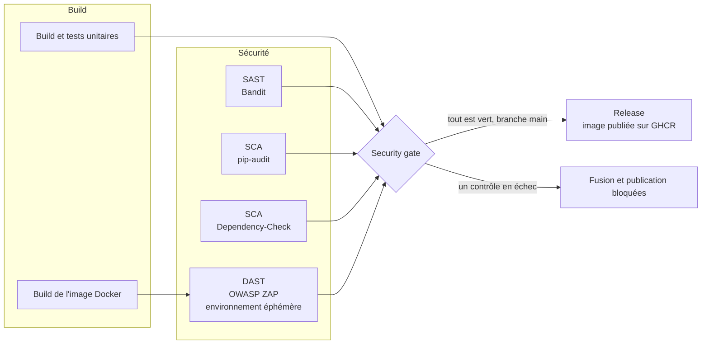

# TP2 DevSecOps : intégration de la sécurité dans un pipeline CI/CD

[](https://github.com/YassineDHML/tp2-devsecops-cicd-pipeline/actions/workflows/ci.yml)

Application de prise de notes (Python/Flask) issue du [TP1](https://github.com/YassineDHML/tp1-devsecops-sast-sca), protégée par un pipeline GitHub Actions qui joue le rôle de **garde-fou de sécurité**. À chaque *push* et chaque *pull request*, il compile, teste et analyse le code (SAST), les dépendances (SCA) et l'application en cours d'exécution (DAST). Il **bloque la fusion et la publication** dès qu'une vulnérabilité haute ou critique est détectée.

Le rapport complet (explications, résultats, démonstration) se trouve dans **[RAPPORT.md](RAPPORT.md)**. Les preuves d'exécution (rapports des scanners, journaux) sont dans [`reports/`](reports/).

## Le pipeline



| Job | Outil | Le pipeline échoue si… |
|---|---|---|
| Build et tests unitaires | pytest, pytest-cov | un test échoue ou la couverture est inférieure à 90 % |
| Build de l'image Docker | Docker | l'image ne se construit pas |
| SAST - Bandit | Bandit | une constatation de sévérité **High** est détectée |
| SCA - pip-audit | pip-audit | une dépendance a une vulnérabilité connue |
| SCA - OWASP Dependency-Check | Dependency-Check | une CVE a un score CVSS **≥ 7** (High ou Critical) |
| DAST - OWASP ZAP | ZAP | une alerte de risque **High** (le plus élevé de ZAP) est détectée |
| Security gate | — | l'un des contrôles précédents n'est pas vert |
| Release | Docker, GHCR | *(branche `main` uniquement, si le gate est vert)* |

La branche `main` est protégée : une pull request ne peut être fusionnée que si le job **Security gate** est vert, y compris pour l'administrateur du dépôt.

## Contenu du dépôt

```
.
├── .github/workflows/ci.yml     # le pipeline
├── app/                         # application Flask (issue du TP1)
├── tests/                       # tests unitaires (application et script de gate)
├── scripts/
│   ├── dast.sh                  # environnement éphémère + scan ZAP + gate DAST (CI et local)
│   └── security_report.py       # résumés des rapports et règle de blocage du DAST
├── zap/automation.yaml          # plan ZAP : scan authentifié (spider + scan actif)
├── reports/                     # preuves d'exécution : PR vulnérable et PR corrigée
├── Dockerfile
├── requirements.txt             # dépendances de l'application (analysées par la SCA)
├── requirements-dev.txt         # pytest, Bandit, pip-audit
└── RAPPORT.md
```

## Reproduire en local

Tests unitaires, SAST et SCA (Python 3.13) :

```bash
python -m pip install -r requirements-dev.txt
pytest --cov=app
bandit -r app --severity-level high
pip-audit -r requirements.txt --no-deps --disable-pip
```

DAST complet (Docker requis ; sous Windows, à lancer depuis Git Bash avec `PYTHON=python`) :

```bash
docker build -t notes-app:ci .
IMAGE=notes-app:ci bash scripts/dast.sh all     # rapports ZAP dans zap-out/
```

La commande `all` crée l'environnement éphémère, lance le scan ZAP authentifié, applique le gate (code de sortie 1 si une alerte High est trouvée), puis détruit l'environnement.

## Démonstration (validation du TP)

| Pull request | Contenu | Résultat |
|---|---|---|
| [#1](../../pull/1) | Route `/diagnostic` volontairement vulnérable et `certifi` ancien | pipeline en **échec** : SAST, SCA et DAST détectent les failles, la fusion est bloquée |
| [#2](../../pull/2) | Même fonctionnalité, corrigée (et ce rapport) | pipeline **vert**, fusion autorisée ; l'image est publiée après la fusion |
